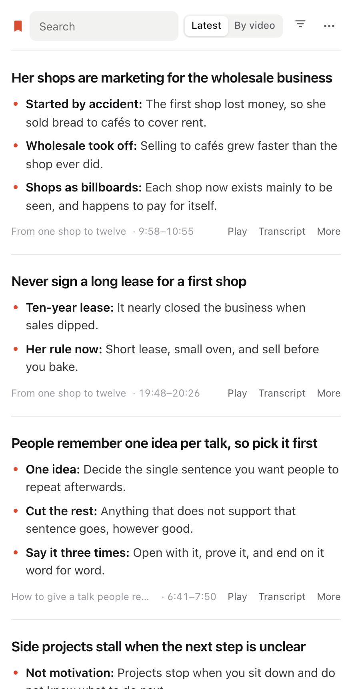
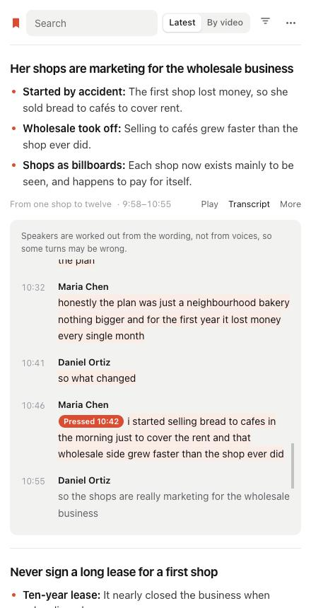
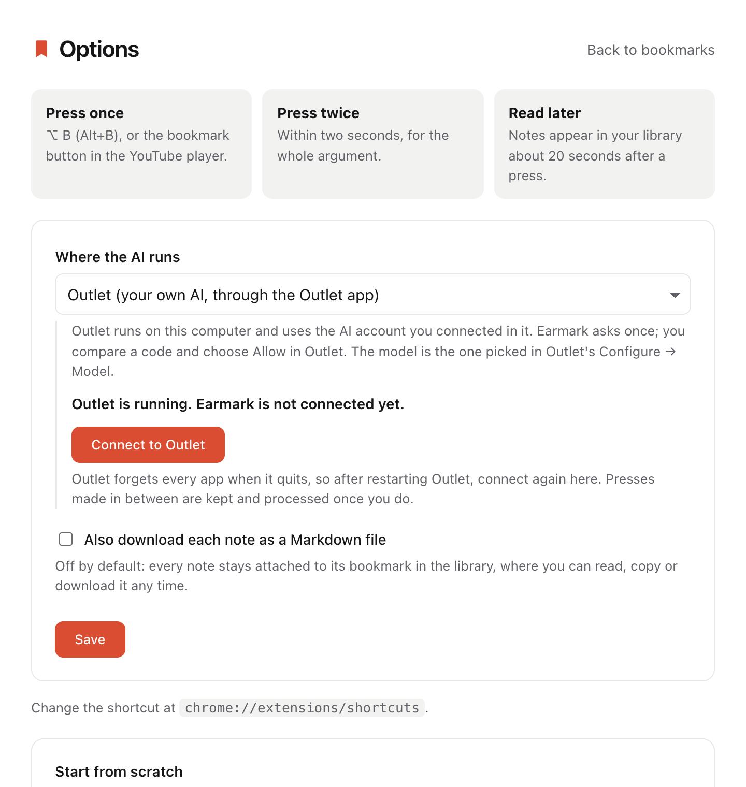

# Earmark

**Press one key while watching YouTube. AI works out what you meant to keep and saves it as a short note.**

Earmark is a Chrome extension for people who learn from podcasts and talks. When something lands, press <kbd>Alt</kbd>+<kbd>B</kbd> (<kbd>⌥</kbd> <kbd>B</kbd> on a Mac) and keep watching. Earmark reads the video's whole transcript, decides which passage you meant (a 20-second line or a two-minute argument), and saves:

- a title that states the idea, and 2–5 short points,
- a link that opens the video at that passage,
- the full transcript, opened at the passage, with who said what.

It is an [Outlet](https://github.com/rohan1chaudhari/outlet)-compatible app: the AI runs on your own ChatGPT/Codex account, through Outlet on your computer. Earmark has no server and no API key. You can also skip Outlet and use the Codex CLI directly (see [Without Outlet](#without-outlet)).

<p>
  
  
</p>

*Screenshots use made-up demo notes.*

## Install

Earmark is not in the Chrome Web Store yet. Load it from this folder:

1. Download or clone this repository.
2. Open `chrome://extensions`, turn on **Developer mode** (top right), click **Load unpacked**, and choose the folder.
3. Earmark's options open. Connect it to Outlet:
   1. Install and open [Outlet](https://github.com/rohan1chaudhari/outlet), and connect your Codex or ChatGPT account in it.
   2. In Earmark's options, click **Connect to Outlet**. A six-digit code appears.
   3. In Outlet's window, check that it says **Earmark (Chrome extension)** with the same code. Choose **Change**, pick **7 days** and **1,000 requests**, then **Allow**.

Outlet forgets every app when it quits, so connect again after restarting it. Presses made in between are kept and processed once you do. Earmark needs an Outlet build that accepts Chrome extensions (protocol from 2026-11-23 onwards).



## Use

- **Press once** (<kbd>Alt</kbd>+<kbd>B</kbd>, or the bookmark button in the YouTube player) to keep the moment. Playback continues; a small card confirms it.
- **Press twice** within two seconds for "the whole argument, not just the last line".
- **Open your notes** with the toolbar icon. They open in Chrome's side panel, beside the video.
  - **Latest** lists notes newest first. **By video** groups them under each video's title.
  - **Play** plays just the passage. **Transcript** shows the whole transcript at your passage, highlighted, with a marker where you pressed. The first time you open a video's transcript, the AI labels who is speaking.
  - **Details** opens class notes on the passage, still in points: a one-line "Remember", sections such as context, the claim, examples and caveats with sub-points, and the key terms explained. They are written the first time you open them (about 20 seconds) and kept with the note; Markdown copy and download include them.
  - **More** has the one-line summary, a verbatim quote, tags, Markdown copy and download, and Delete. It also asks whether the passage was right: **Wider** or **Narrower** re-runs the guess.
  - Search is always there. **Filters** narrows by date, channel, video, category or tag.

Change the shortcut at `chrome://extensions/shortcuts`.

## How it works

Each press saves the video position and the video's captions straight away, so nothing is lost if the AI is busy. Then two model calls run:

1. **Which passage?** The model gets the whole transcript, with the press time marked, and picks the start and end of what you most likely meant. There are no fixed time rules.
2. **The note.** The model rewrites that passage as a title and points, picks a quote (kept only if it appears word for word), and files it under a category and tags, reusing ones you already have.

Speaker names are a third call, made once per video, only when you open its transcript. YouTube captions carry no voice information, so the speakers are inferred from the wording and can be wrong in fast exchanges.

## Without Outlet

Earmark can call the [Codex CLI](https://learn.chatgpt.com/docs/codex/cli) you are already signed in to, through a tiny local bridge. Needs Node 22 or newer.

1. In Earmark's options, choose **Local Codex CLI**. You can set the model and reasoning effort there.
2. Start the bridge from this folder and leave it running while you watch:

   ```bash
   node local/server.mjs
   ```

The bridge listens on `127.0.0.1:8765` only and refuses requests that don't come from a browser extension. It runs Codex with its tools disabled, in a read-only sandbox and an empty temporary folder.

## What leaves your computer

- For each press: the video's title, channel, description and full transcript go to the AI you chose (your Codex or ChatGPT account, through Outlet or the Codex CLI). Nothing else does.
- Notes, transcripts and settings stay in Chrome's storage on your computer. **Delete all data** in Options removes them.
- Earmark has no server, analytics or account of its own.

## Known limits

- Desktop Chrome and YouTube only.
- Videos without captions keep the press and its link but get no note. Live streams are skipped.
- If captions can't be read at the moment of a press (an ad, the player still loading), the press waits and Earmark tries again while the video is open, and next time you open it.
- Captions flicker on for a moment the first time you press on a video, while the transcript is read.
- **Play** embeds YouTube in an extension page, which YouTube may refuse. The time link under each note always opens the passage on YouTube.
- Through Outlet, the model is the one picked in Outlet, which runs Codex at low reasoning effort. The CLI bridge lets you choose the effort.

## Develop

No build step and no dependencies. Run the tests with:

```bash
node --test test/
```

| File | Role |
| --- | --- |
| `page.js` | Runs in the YouTube page; reads the player position and the caption track |
| `content.js` | Shortcut, player button, confirmation card, double press |
| `background.js` | Press queue, model calls, retries |
| `lib/pipeline.js` | Prompts, schemas, passage and note cleaning, Markdown rendering |
| `lib/library.js` | Search, filters, grouping, transcript layout |
| `lib/outlet.js` | Pairing with Outlet and sending requests through it |
| `local/server.mjs` | The optional Codex CLI bridge |
| `bookmarks.html`, `bookmarks.js` | The notes library |
| `options.html`, `options.js` | Settings and the Outlet connection |

## License

[Apache-2.0](LICENSE). Earmark is independent of YouTube, Google and OpenAI.
